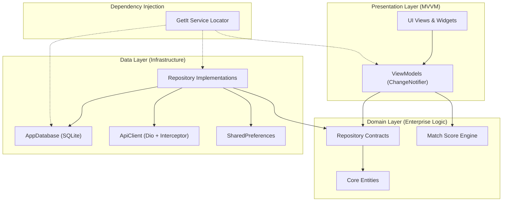
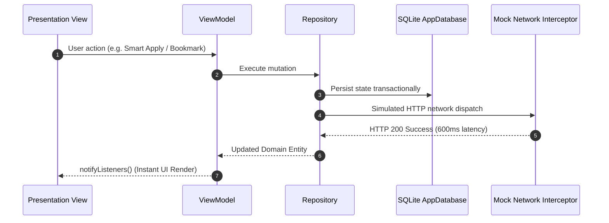

# OpenPro

[](https://github.com/Safeer-Hussain/openpro/actions/workflows/ci.yml)

OpenPro is an enterprise-grade, offline-first professional social network, vertical job discovery engine, and recruiter-talent matching platform built with Flutter. Designed for high performance, visual precision, and zero-latency mobile responsiveness, OpenPro bridges the gap between ambitious engineering talent and technical hiring teams through localized heuristic matching, on-device artificial intelligence assistance, and immersive professional content streams.

---

## Architecture Overview

OpenPro adheres to Feature-First Clean Architecture and Model-View-ViewModel (MVVM) design patterns. The codebase isolates business rules from presentation and infrastructure, ensuring deterministic testability, strict dependency inversion, and long-term maintainability.



### Data Flow & Offline-First Strategy

The platform operates without requiring external commercial cloud keys. Every write, read, and search query executes against a transactional local SQLite database, supplemented by configurable network simulation to replicate real-world latency, retry policies, and error handling.



---

## Core Production Modules

### 1. Vertical Job-Offer Feed and 1-Tap Smart Apply
- **Vertical Feed & Grid Formats:** Fluid portrait swipe discovery alongside an adaptive dual-pane master-detail list for tablets and landscape displays.
- **Dynamic Heuristic Matching:** Real-time percentage compatibility scoring computed from user profile skills, seniority, and role requirements via `MatchCalculator`.
- **1-Tap Smart Apply:** Modal application workflow featuring cover note validation, instant SQLite persistence, and multi-state status tracking (Applied, In Review, Interview Scheduled).
- **Interactive Share Sheet:** Clipboard export, professional network feed reposting, and match card serialization.

### 2. Interactive Stories and Professional Community Feed
- **Professional Stories:** Horizontal showcase carousel for architecture highlights, project milestones, and hiring spotlights. Features animated progress bars, touch-and-hold pause, and interactive reactions.
- **Community Post Stream:** High-density technical feed supporting code snippets, project launch cards, and milestone achievements.
- **Full Social Interactivity:** Zero-latency optimistic likes, nested SQLite-backed comment threads, and bookmark management.

### 3. On-Device AI Career Assistant
- **Context-Aware Recommendations:** Integrates directly with the user profile, applied opportunities, and saved jobs stored in the local SQLite graph.
- **Token-by-Token Streaming:** Realistic asynchronous token streaming with deterministic completion guarantees wrapped in structured `try ... finally` blocks.
- **Quick-Prompt Library:** Pre-configured prompts for match evaluation, tailored cover pitch drafting, skill gap diagnostics, and simulated technical interview questions.

### 4. Thematic Community Groups and Exclusive Events Hub
- **Curated Professional Groups:** Domain-specific networks (Flutter Architects, Applied AI Systems, Cloud DevOps Guild, FinTech Engineering) with membership toggling and member counting.
- **Technical Events Engine:** Virtual conferences, architectural roundtables, and technical workshops with RSVP toggling and participant tracking.

### 5. Profile, Portfolio and Recruiter Analytics
- **Executive Profile Showcase:** Comprehensive portfolio presentation including experience timelines, verified credentials, and interactive skill clouds.
- **Interactive Recruiter Telemetry:** Built with `fl_chart`, visualizing weekly profile views, recruiter search appearances, and candidate comparison metrics across adjustable time intervals.
- **Developer & Recruiter Debug Drawer:** Built-in simulation tool to toggle simulated latency (0ms to 2000ms), trigger HTTP 503 error states, and fire mock recruiter push notifications.

---

## Design and Safety Engineering

OpenPro enforces strict engineering principles to prevent common UI and platform issues:

- **Zero Hardcoded Colors:** All colors dynamically resolve through `Theme.of(context).colorScheme`. The application seamlessly transitions between Light and Dark Material 3 themes with instantaneous rendering.
- **Unique Hero Tag Safety:** Every `FloatingActionButton` defines an explicit, unique hero tag across all navigational tabs to prevent scheduler collisions during route transitions.
- **Landscape Viewport Safety (800x360dp):** Complete structural support for compact viewports. In landscape, navigation pivots to a compact `NavigationRail` inside a `SingleChildScrollView` with `IntrinsicHeight`, app bars compress to 36dp, and grid views use explicit `mainAxisExtent` bounds to eliminate `RenderFlex` overflows.
- **Keyboard Docking and Touch Safety:** The root application wraps in a gesture detector to dismiss keyboard focus on outside taps. Modals and chat views adaptively adjust for insets without double-padding artifacts.
- **Zero Emojis Policy:** Strict professional aesthetic utilizing vector Material Symbols and iconography throughout all UI components, debug logs, and documentation.

---

## Directory Layout

```
open_pro/
|-- .github/
|   `-- workflows/
|       `-- ci.yml                   # Automated CI workflow
|-- .antigravity/
|   `-- rules.md                     # Agentic automation rules
|-- assets/
|   |-- icons/                       # Vector & launcher icons
|   `-- images/                      # Curated company, cover, and story assets
|-- docs/
|   |-- AUTONOMOUS_BACKLOG.md        # 25-sprint engineering roadmap
|   `-- PRD.md                       # Comprehensive Product Requirements Document
|-- lib/
|   |-- core/                        # Constants, theme, SQLite database, network, notifications
|   |-- data/                        # Models, data sources, and repository implementations
|   |-- domain/                      # Entities, repository contracts, and calculation engines
|   |-- presentation/                # ViewModels, Views, and Widgets organized by module
|   `-- main.dart                    # Application bootstrap & provider tree
|-- test/
|   |-- helpers/                     # Test harness & database mock configurations
|   |-- unit/                        # ViewModels and utility test suites
|   `-- widget/                      # Layout safety, hero tags, and theme tests
|-- pubspec.yaml                     # Dependencies and asset declarations
|-- rules.md                         # Autonomous backlog execution rules
`-- README.md                        # Project documentation
```

---

## Getting Started

### Prerequisites
- Flutter SDK: `>=3.2.0` (Stable channel)
- Dart SDK: `>=3.2.0 <4.0.0`
- Android Studio / Xcode / VS Code with Flutter extension
- Operating System: macOS, Linux, or Windows

### Installation and Execution

1. Clone the repository:
   ```bash
   git clone https://github.com/Safeer-Hussain/openpro.git
   cd openpro
   ```

2. Retrieve dependencies:
   ```bash
   flutter pub get
   ```

3. Run static analysis:
   ```bash
   flutter analyze
   ```

4. Execute automated test suites:
   ```bash
   flutter test
   ```

5. Launch the application:
   ```bash
   flutter run
   ```

---

## Automated Verification Matrix

The test suite covers unit logic, reactive state transitions, and responsive rendering constraints:

| Test Suite | Scope | Status |
| :--- | :--- | :--- |
| `match_calculator_test.dart` | Skill overlap & heuristic percentage calculation | Passed |
| `job_feed_viewmodel_test.dart` | Job filtering, bookmarking, and application dispatch | Passed |
| `social_feed_viewmodel_test.dart` | Post creation, like toggle, and comment handling | Passed |
| `ai_assistant_viewmodel_test.dart` | Token stream handling and prompt dispatch | Passed |
| `community_viewmodel_test.dart` | Group membership and event RSVP state | Passed |
| `profile_viewmodel_test.dart` | Skill management, experience updates, and analytics | Passed |
| `hero_tag_safety_test.dart` | FAB hero tag uniqueness across all navigation destinations | Passed |
| `landscape_viewport_test.dart` | 800x360dp landscape overflow verification | Passed |
| `theme_switch_and_chart_test.dart` | Material 3 theme toggle and chart rendering | Passed |

---

## Clean-Room Engineering Disclaimer

This software has been architected and developed under strict clean-room engineering standards. All organizational names, logos, candidate data, recruiter communications, job postings, and metrics are entirely synthetic and generated for demonstration, testing, and portfolio verification purposes. No confidential, proprietary, or non-public trade secrets from any commercial entity have been referenced, utilized, or incorporated into this repository.

---

## License

This project is licensed under the MIT License. See the [LICENSE](LICENSE) file for details.
